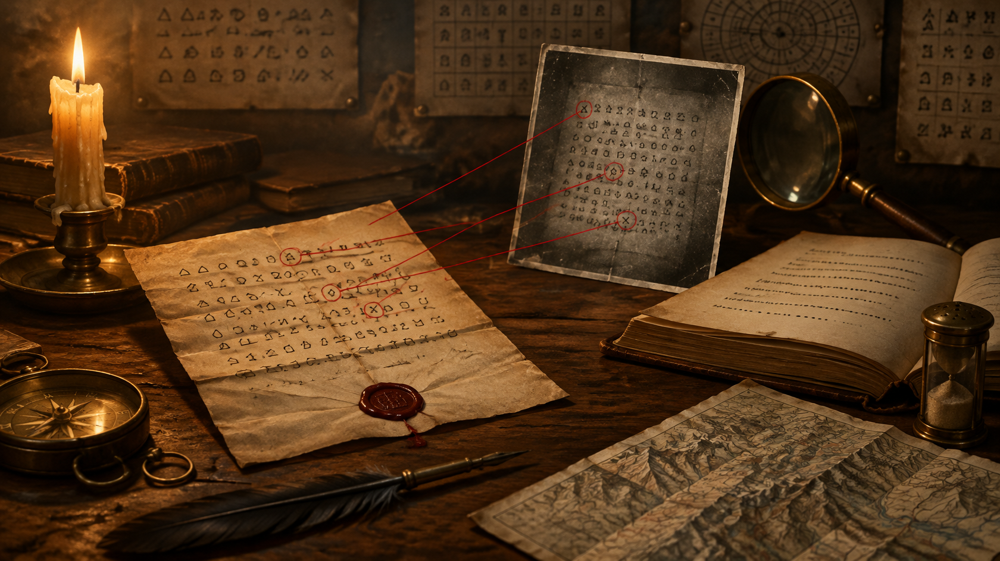

Volume 18 of the *Correspondance de Napoléon Ier*, printed in Paris in 1865, carries Napoleon's order to his stepson Eugène of 16 March 1809. One sentence in it trails off: *par une poignée de . . . . . . . .*, "by a handful of," followed by a row of dots. The editors left the end of the sentence out.

A cipher letter sent from Eugène's headquarters to General Auguste de Marmont later that month appears to finish that sentence. In the reading [Carter Church published on 18 September](https://carter.church/writeups/the-letter-to-marmont/), Marmont is told not to be intimidated by *quelques troupes ou un rassemblement de canailles*, "a few troops, or a gathering of rabble." Church is careful to call this a paraphrase. It records what the order was passing on, and Napoleon's exact word is still unknown. Still, a ciphertext that turns out to hold the substance of a printed elision is a lovely thing to find.

[Klaus Schmeh mentioned the solution on 30 October](https://klausschmeh.net/a-few-cryptographic-things-i-havent-blogged-about-yet/) in a round-up of things he had not yet covered, and [Euronews ran it on 2 October](https://www.euronews.com/2026/10/02/ai-decodes-217-year-old-napoleonic-letter-in-6-hours) under a headline about six hours of AI. The six hours are the least interesting part.

## One plate, wrong year

The original letter is not located anywhere in Church's account. The only known reproduction is a plate after page 24 of [Lieutenant-Colonel J. Vilcoq's "Le Chiffre sous le Premier Empire"](https://www.persee.fr/doc/rharm_0035-3299_1969_num_25_4_8686), published in the *Revue historique des Armées* in 1969 and digitised by Persée. That plate is the whole evidence base: 1,202 by 1,836 pixels, roughly 19 pixels per sign, no shelfmark.

Satoshi Tomokiyo's catalogue [Cryptiana](https://cryptiana.web.fc2.com/code/unsolved.htm) listed it as a letter to Marmont from 1807, with its plain first line and a description of the system. Daniel Tant had worked out 33 letter values, published through ARCSI, with every word-sign cell left blank. Another solver who looked at it wrote that there was "nothing to work on," which Church reads as a comment on access more than on difficulty: almost nobody had the full ciphertext in front of them.

The system is a homophonic substitution. Church's transcription gives 1,300 cipher units and 155 distinct signs. Common letters have several interchangeable signs, 29 signs stand for whole words such as *de*, *que* and *général*, and about 70 are invented marks with no printed equivalent. Tant's values covered a third of the text. The rest had to be recovered.

## The text that dated itself

The re-dating is my favourite part, and it needed no cryptanalysis at all once the plaintext existed. The letter lists seven bodies of troops in a fixed order with fixed strengths: the Duke of Danzig with 40,000 Bavarians, Poniatowski with 30,000 Poles on the Vistula, the Duke of Auerstaedt with 80,000 French at Bayreuth, and so on. Those are the same forces, in the same order, with the same figures, as the order of 16 March 1809.

The plain first line also acknowledges Eugène's letters of 8, 14 and 20 March, which are printed in Marmont's memoirs. So the letter falls after 20 March and, given what it says about Austrian positions, before Austria crossed the Inn on 10 April. Cryptiana now marks it solved, with a note that the date should be 1809, and links Tomokiyo's own preliminary verification.

There is a nice symmetry with [the Christopher Love page](/posts/2026-10-04-younger-than-the-prophet.html) from early October, where the writing system put a floor under the date before anyone read a word. Here the content does the dating. A dispatch that relays an order inherits that order's date, and the order happens to be in print.

## What the model did, and the check that mattered

Church says plainly that he had never broken a cipher before. In his account, OpenAI's GPT-6 Astra did the work in about six hours of model time: it cut the plate into 24 strips, read 175 provisional marks, decided which of them were the same sign drawn twice, and reduced them to 155. Then came simulated annealing, scoring candidate decryptions against French 3-, 4- and 5-gram statistics drawn from Hugo, Dumas and Marmont's own memoirs. Signs that kept spoiling otherwise good French were tried as whole words, and every proposed value was checked against every place that sign occurs on the plate.

Church notes that transcription and cryptanalysis are usually separate skills. Having one system do both is the change worth watching, because transcription choices are usually where an error hides in plain sight.

The check I would put first is a different one. The language model that scored the candidates included Marmont's memoirs, and those memoirs print the letters this one answers. A solver scored on that corpus could, in principle, be pulled toward text it had partly seen. So Church reran the whole search with Marmont and every Napoleonic text removed from the scoring statistics, and reports that it recovered the same reading. That is the right test, because it takes away the one shortcut that could have produced a convincing but borrowed plaintext.

It removes the shortcut from the n-gram scorer. Whatever Astra itself absorbed in training is a separate question that the rerun does not reach, and Church does not claim it does. The safeguard here is the per-sign check against the plate: a value is kept only if it holds at every occurrence, and no amount of remembered Napoleon can make a mark on a 1969 photograph say something it does not.

## What is still open

Church lists five signs he could not settle, with best guesses: "Sa Majesté" or "l'Empereur", "de" or "dans", "canailles" or "canaille", and two more of that kind. He says none would change the meaning, and that the thinnest evidence belongs to signs that appear exactly once. A sign seen once can only be checked against itself. The whole reading rests on one low-resolution plate of an original nobody has pointed to.

Tomokiyo's review is the only outside check I could find. Most of the coverage repeats Church's write-up, which is at least a careful one: it ships the transcription, the cipher tables, and scripts to reproduce and verify the result.

What I keep returning to is the plate. If the letter itself turns up in a French military archive, the ink would probably settle most of the five open signs quickly. Does anyone know where Vilcoq photographed it?

<!--
HERO_IMAGE_PROMPT:
Romantic painterly illustration in the manner of Nick Bantock's Griffin & Sabine meets Bletchley Park 1942, sepia and candlelight, photographic-painterly composition, not photorealistic. On an antique oak campaign desk lit by a single candle lies a folded military dispatch sealed with dark red wax, its paper covered in rows of small invented hand-drawn cipher signs in iron-gall ink. Beside it an open leather-bound printed volume shows a line of type that dissolves into a row of small dots. A faded black-and-white photographic plate of the same cipher page rests propped against a brass magnifying glass. Thin red string runs from three signs on the dispatch to matching marks on the photographic plate. A brass compass, a quill, a sand shaker and a folded map of the Alps sit at the edges. Faint cipher tables pinned in the background, soft candle haze, contemplative, pattern-recognition mood. No human figures anywhere. No legible text. 16:9 horizontal composition.
-->

<!--
SOCIAL_CAPTIONS:

INSTAGRAM:
In 1865 the printed edition of Napoleon's correspondence cut one of his sentences off with a row of dots. A cipher letter sent to General Marmont in 1809, read this autumn, seems to carry what was cut.

Full piece linked in bio.

#cryptography #ciphers #codebreaking #history #napoleon #historicalcryptology
-->
