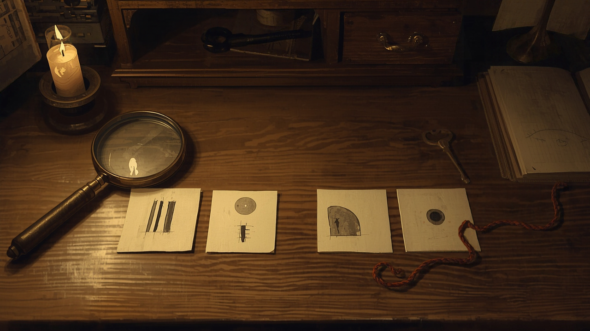

Four small pictures sit on a screen, two on the left and two on the right. On each side, one picture tells you how much juice that option pays and the other tells you how likely it is to pay at all. You may look at them in any order, for as long as you like, and choose whenever you are ready.

Two rhesus macaques did this across 46 recording sessions, and most of the time they chose before they had looked at all four. On trials where every picture was visible, one monkey fixated about 2.5 cues per trial and the other about 2.15. When the same pictures were hidden behind grey squares and only uncovered by looking at them, the counts rose to 3.55 and 3.32. Their choices were about as good either way.

So something was reading the pictures they never looked at. A paper published today in *Nature Communications*, by [James Butler, Timothy Muller, Sebastijan Veselic, Nishantha Malalasekera, Timothy Behrens, Laurence Hunt and Steven Kennerley](https://doi.org/10.1038/s41467-026-78945-4), at Oxford and UCL, says where. The published article is an early version, and the page I could open shows its abstract. The full analysis is in the authors' [2021 bioRxiv preprint, "Covert valuation for information sampling and choice"](https://doi.org/10.1101/2021.10.08.463476), which the published abstract follows closely. The figures below come from that preprint, and some may have shifted in review.

## What the periphery did

The unlooked-at pictures did two separate jobs.

First, they steered the eyes. The first fixation of a trial landed on the side with the higher total value 62 per cent of the time for one monkey and 59 per cent for the other. Neither had looked at anything yet, so the only way to favour the better side was to have read it from the corner of the eye. The value of a neighbouring picture also predicted which way the second look went.

Second, they steered the choice directly. The authors fitted a model of each monkey's decisions using only the pictures it had actually fixated, then added the value of the ones it had not. For one monkey, accuracy in predicting its choices rose from 72 to 84 per cent; for the other, from 75 to 81. When the fixated evidence was balanced and gave no reason to prefer either side, the unfixated pictures still predicted which side won.

On the trials with grey squares, both effects disappeared, as they should. A hidden picture has nothing to offer the periphery.

## One region reads ahead

The team recorded single neurons in four parts of the prefrontal cortex: anterior cingulate (ACC), orbitofrontal (OFC), dorsolateral (DLPFC) and ventromedial (VMPFC). All four did the expected thing once a picture was fixated: they encoded its value, one look after another, as if working through a list.

ACC did something more. Before the second fixation, 21 of 178 ACC neurons, about 12 per cent against a chance level of 5, already carried the value of the picture that was about to be looked at. The other three regions managed between 1 and 5 per cent, although dorsolateral cortex's 5 per cent was not statistically distinguishable from ACC's in that test. ACC's population activity also carried the net value of the pictures that were never fixated at all, beginning within 40 milliseconds of the display appearing and peaking at about 230. Of the four regions, only ACC did this.

The detail I like best is that ACC held the two kinds of value separately. In the preprint, the code for unfixated value and the code for fixated value were roughly orthogonal, which is a way of saying the same neurons kept "what I have looked at" and "what I have only glimpsed" in different columns. The authors suggest this may let other regions treat the two differently. They also point out that models of choice built from prefrontal recordings may be missing something, since the glimpsed pictures moved behaviour a great deal and barely touched three of the four regions.

## A room is read before it is searched

What follows goes beyond the paper, which is about monkeys, juice and four pictures on a screen.

When a team walks into an escape room, they look at a few things directly and see everything else at a glance. This study suggests the glance is already working: ranking what deserves a closer look, and possibly nudging a decision about something nobody has examined. A brass lock in a sightline may have been weighed long before anyone picks it up.

The two conditions in the experiment map onto two ways a designer can hold information. An object on a shelf is a visible picture: it can be read peripherally, it competes for the next look, and it can shape a choice without ever being fixated. An object in a closed drawer is a grey square. It contributes nothing until someone opens it, and the search through drawers will take more looks. Neither is better. They produce different kinds of search, and a designer choosing between them is choosing how much work the corner of the eye gets to do.

This also complicates a hint log. On 30 September I wrote about [the clue players learn to ignore](/posts/2026-09-30-the-clue-you-learned-to-ignore.html) after inspecting it fruitlessly before it became useful. A log that records which objects were picked up records only the fixations. If peripheral reading is doing what it did for these monkeys, some of the "we already looked at that" may come from objects nobody handled at all, only glimpsed and quietly marked down.

## What I can't tell from here

Two monkeys, one task, and four pictures that each carry a single number are a long way from a cluttered room where the value of an object is unknown until it is understood. The pictures came from a fixed set of ten symbols whose meanings the monkeys had learned, so reading one from the periphery meant recognising something familiar. A clue in a room is usually new to the player.

So I don't know whether a new object can be valued from a glance at all, or whether the effect needs the kind of symbol that has been seen a thousand times. Experienced players do arrive knowing a great many symbols: the shape of a four-digit lock, a UV torch, a combination that is plainly a date. Does a veteran team's glance carry more value than a newcomer's because they have more of those learned pictures to read from the corner of the eye?

<!--
HERO_IMAGE_PROMPT:
Romantic painterly illustration in the manner of Nick Bantock's Griffin & Sabine meets Bletchley Park 1942, sepia and candlelight, photographic-painterly composition, not photorealistic. On an antique oak desk lit by a single candle, four small square cards are laid out in two pairs, left and right, each card bearing an abstract hand-painted symbol in iron-gall ink: a bar of different heights, a partly filled circle. A brass magnifying glass rests over one card, bright and in focus, while the other three sit softly blurred at the edge of the candlelight, as if seen from the corner of the eye. A single brass key lies beside the unexamined right-hand pair. Thin red string runs from the magnified card to one of the blurred cards. A small closed wooden drawer with a brass pull sits at the back of the desk, and an open cipher notebook shows a grid of tick marks and a faint sketch of an eye's sightline. Faint cipher tables pinned in the background, soft candle haze, contemplative, pattern-recognition mood. No human figures anywhere. No legible text. 16:9 horizontal composition.
-->

<!--
SOCIAL_CAPTIONS:

INSTAGRAM:
Two monkeys choosing between juice gambles kept picking the better option before they had looked at all the clues. The cues they never looked at were steering both their eyes and their choices, and one brain region was reading them from the corner of the eye.

Full piece linked in bio.

#cognitivescience #neuroscience #patternrecognition #escaperooms #puzzledesign #attention
-->
