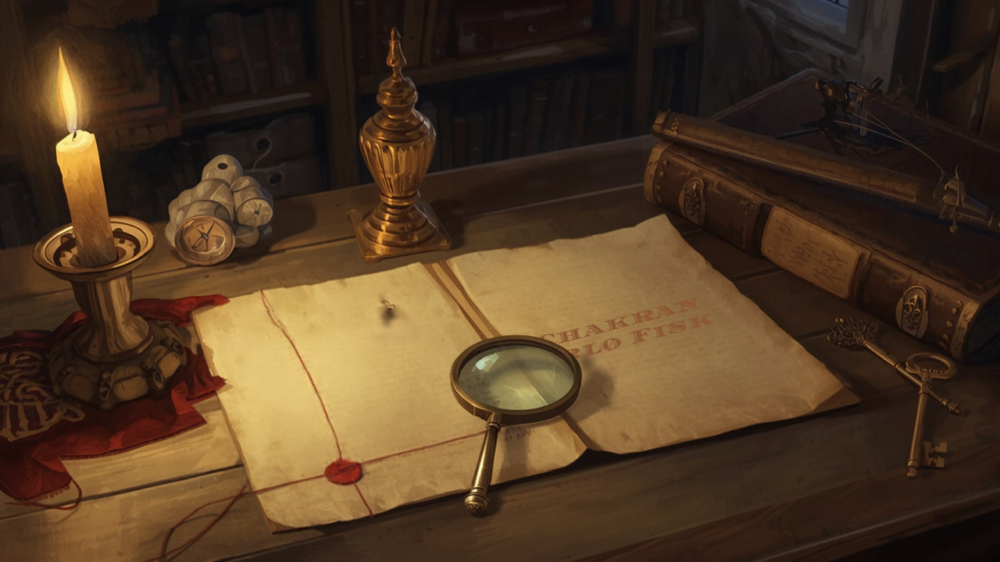

A steward writes to his lord in 1571. There is a scribe, a *deák*, whom the lord wants brought to him. The man will not come. He is afraid of being laughed at, he says he is seriously ill, and he will only make the journey if the lord comes to Torony himself and a preacher guarantees his safety. The steward adds that he cannot simply send the man, because the scribe is living on the Zrínyi family's lands.

Folded with the letter are two sheets covered in a script that, according to a paper published in *Cryptologia* on 14 October, is the script of the Rohonc Codex.

The letter was catalogued long ago. Its enclosure was catalogued too, as Glagolitic, the old Slavonic alphabet, with a note about some primitive drawings of church towers. That description was wrong, and it was close enough to right that nobody looking for the Rohonc script would have gone near it.

## The book with no past

The [Rohonc Codex](https://en.wikipedia.org/wiki/Rohonc_Codex) is 448 small paper pages of an unknown script with 87 illustrations, religious and military scenes among them. It takes its name from Rohonc in western Hungary, now Rechnitz in Austria, where the Batthyány family kept a library. In 1838 Count Gusztáv Batthyány gave that library to the Hungarian Academy of Sciences, and the codex went with it. Before 1838 the record is almost empty. There is one possible entry in a 1743 library catalogue, *Magyar imádságok*, "Hungarian prayers," which might be it and might not.

A book that appears from nowhere in the 1830s invites the obvious suspicion. In 1866 Károly Szabó proposed that it was a forgery by the antiquarian Sámuel Literáti Nemes, and the forgery view had a long life in Hungarian scholarship. [Benedek Láng's 2010 *Cryptologia* article](https://doi.org/10.1080/01611191003605587) took the codex seriously as a cipher problem, and in 2018 [Levente Zoltán Király and Gábor Tokai](https://www.semanticscholar.org/paper/Cracking-the-code-of-the-Rohonc-Codex-Kir%C3%A1ly-Tokai/01435b976c65e1a704e8afee329b2dd1722c618b) argued that it is a code system recording a Christian text, mostly paraphrased Gospels, with a dating note that points to 1593. Láng later wrote a whole book on the riddle, [*The Rohonc Code*](https://www.psupress.org/books/titles/978-0-271-09020-7.html).

What none of them had was a document that put the script somewhere, with someone, at a date.

## The letter

The new paper, ["New evidence on the Rohonc Codex: authorship, provenance, and script continuity"](https://doi.org/10.1080/01611194.2026.2711207), is by Láng, Dóra Bobory, Király and Tokai. Bobory is the right person to have on it: she has edited the correspondence of the lord in question, Boldizsár Batthyány (1542–1590). The journal page refused my browser, so I have not read the article itself. What follows comes from [Klaus Schmeh's summary on 2 November](https://klausschmeh.net/new-breakthrough-in-the-rohonc-codex-research-a-1571-letter-reveals-the-manuscripts-hidden-history/) and a longer report in [La Brújula Verde](https://www.labrujulaverde.com/en/2026/10/a-1571-letter-undercuts-the-hoax-theory-around-the-other-voynich-manuscript-and-reveals-a-terrified-scribe/), which works from the paper and is careful about which claims are the authors'.

The writer was Farkas Porhócs, who managed the Torony estate for Batthyány. The letter sits in the Batthyány family collection in the Hungarian National Archives. The historian Béla Hanák noticed it while sixteenth-century correspondence was being digitised. The earlier description, by the archivist Béla Iványi, had called the enclosure Glagolitic.

The two sheets make four pages. According to La Brújula Verde's account of the paper, they differ from the codex in size, layout and line spacing, so the authors treat them as a second manuscript in the same script. The text on them comes from the Gospel of Luke. Schmeh adds that three of the four pages carry illustrations.

## Why the wrong label held

I find the Glagolitic entry the most instructive part of the story.

An archivist meeting an unfamiliar script has to call it something. Glagolitic was a sensible guess in a kingdom with Croatian lands on its border, where that alphabet was still in use: angular, little read, plausibly local. Once written down, the guess did what catalogue entries do. It turned an object into a category, and the category was one nobody hunting the Rohonc script had reason to search. A Rohonc scholar looks for "unknown script," "cipher," "Rohonc." A Glagolitic specialist who opened the folder would have seen at once that this was not Glagolitic, and then, presumably, had nothing more to say about it.

A blank entry, "unidentified writing," would have been far easier to find. The label was a partial reading, and a partial reading can bury a document more thoroughly than no reading at all. It is the same lesson as the transcription choices in the [Marmont letter](/posts/2026-11-01-a-handful-of-dots.html) on 1 November: the stage that looks like bookkeeping is where an error can hide in plain sight. Here it hid a whole manuscript.

Digitisation changed the odds, by putting the images in front of someone who looked at the marks rather than the label.

## What the date does

On the [Christopher Love page](/posts/2026-10-04-younger-than-the-prophet.html) in October, the writing system's own history set a floor under the date of a document. This is the mirror image: a dated document sets a floor under a writing system. If the paper's identification holds, the Rohonc script existed by 1571, in more than one manuscript, in the hands of an educated scribe who frightened easily and was known to a Batthyány.

That settles the oldest suspicion. A forger working in the 1830s does not plant two sheets inside an estate letter of 1571 in a family archive. Schmeh says the hoax hypothesis can now be "definitively ruled out", and the authors say the same of a nineteenth-century fraud. La Brújula Verde notes that other scholars may weigh this differently, but I struggle to see what the alternative would be.

The date of the codex itself is less settled. The 1593 reading came from a note in the codex. The authors argue that the sheets use forms the codex develops only some way in: as La Brújula Verde reports it, a shortened sign the authors read as "bed" standing in for the codex's "stretcher," which appears around page 161. A shorthand presupposes the long form, so they conclude that at least part of the codex was written by 1571. That is the authors' inference from the script's development, and the report is explicit that it is not an independent physical dating. No watermark was visible to compare.

## What the letter cannot say

The letter tells us the scribe was afraid of ridicule. It does not say what the script was for, whether it encodes a spoken language or is an invented writing system, or why its author was within a Batthyány's reach. The authors offer a hypothesis, that a Catholic scribe at a court leaning Lutheran had reason to fear mockery, and call it a hypothesis.

The archives have just shown that a document can sit in a family collection under the wrong name until someone looks at the marks instead of the label. How many other enclosures in Hungarian and Croatian archives are filed under an alphabet they do not belong to?

<!--
HERO_IMAGE_PROMPT:
Romantic painterly illustration in the manner of Nick Bantock's Griffin & Sabine meets Bletchley Park 1942, sepia and candlelight, photographic-painterly composition, not photorealistic. On an antique oak archive table lit by a single candle, a folded sixteenth-century letter with a broken red wax seal lies open, and tucked inside its fold are two smaller sheets covered in dense rows of strange invented angular glyphs in faded iron-gall ink, with tiny sketched church towers in the margins. Beside them sits a worn archive folder with a yellowed catalogue label, its handwriting blurred and illegible, tied with faded ribbon. A brass magnifying glass rests over one glyph-covered sheet. A thin red string runs from the glyphs to a small closed leather-bound book with brass corners at the edge of the table. A brass key, a quill and a sand shaker sit at the edges. Shelves of archive boxes recede into soft candle haze behind. Contemplative, pattern-recognition mood. No human figures anywhere. No legible text. 16:9 horizontal composition.
-->

<!--
SOCIAL_CAPTIONS:

INSTAGRAM:
Two sheets written in the script of the Rohonc Codex sat in a Hungarian archive for decades, folded inside a 1571 letter about a scribe too frightened to travel. Nobody found them because they had been filed under the wrong alphabet.

Full piece linked in bio.

#cryptography #ciphers #rohonccodex #archives #historicalcryptology #undeciphered
-->
