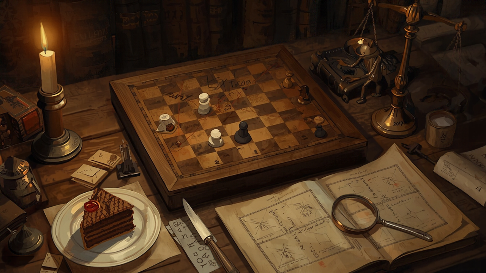

A chess problem is supposed to have exactly one key, one first move that forces mate in the stated number. If a second first move also works, the problem is [cooked](https://en.wikipedia.org/wiki/Chess_problem), and the convention is to call it unsound. When a problem tourney publishes its awards, a window of a few months follows in which anyone may challenge a winner's soundness, and the award is revised if the claim holds.

The word stuck with me while reading Amit Katwala's piece in *MIT Technology Review* on 3 November, ["How 'reverse game theory' could keep AI agents in check"](https://www.technologyreview.com/2026/11/03/1147934/reverse-game-theory-mechanism-design-ai-alignment/). It is about mechanism design: writing the rules of a game so that the behaviour you want is the behaviour that pays, whatever the players privately intend. Every mechanism in it can be cooked, and a puzzle setter would see that before an economist.

## The rule that makes honesty pay

The article's examples are the classic ones. One person cuts a cake and the other chooses first, so the cutter's best move is to cut evenly. In a second-price auction the winner pays the runner-up's bid, so bidding your true value stops being a sacrifice. Nobody has to trust the cutter or read the bidder's mind. The rules do the trusting.

The appeal for AI is plain. Models can deliberately underperform on tests; [van der Weij and colleagues](https://arxiv.org/abs/2406.07358) showed in 2024 that frontier models could be prompted to score lower on dangerous-capability evaluations while keeping their scores on harmless ones, and called it sandbagging. If you cannot see inside a model well enough to know whether it is holding back, perhaps you can arrange the game so that holding back loses.

## Two designs

The article describes two proposals. I have read the abstracts of both papers, not the full texts.

The first is by the MIT economist Stephen Morris with Dirk Bergemann and Andrew Koh, ["Mechanism Design for Alignment and Control"](https://arxiv.org/abs/2609.01595) (arXiv 2609.01595). Its central assumption is what the abstract calls one-sided imitation: an agent can hide a capability it has, but it cannot fake one it lacks. Sandbagging is one of their five worked examples, alongside peer scoring and reward coupling that sets agents competing. In the article's telling, one scheme rewards a model for how well its answers predict what a second model will say, which makes playing dumb a losing bet.

The second is from the Princeton computer scientist Elad Hazan with Rohit Agarwal, Joshua Lin and Mark Braverman, ["AI Alignment via Incentives and Correction"](https://arxiv.org/abs/2605.01643) (arXiv 2605.01643, third version). Models take turns as solvers and auditors. A solver caught cheating is punished, and so is an auditor who misses a cheat. The abstract contains the finding I would put at the top of any summary: harsher penalties can deter the solver and also weaken the auditor's reason to look, because inspection then costs effort on a population that seems to be behaving. Their response is to reward the whole correction event (whether the solver erred, whether the auditor inspected, whether the error was caught) rather than the final answer alone.

## Setters already do this

A logic puzzle is a mechanism. The setter knows the answer and wants the solver to reach it by one chain of deductions. The rules and clues are written so that the only route to the answer passes through the intended steps. A cook is a route the setter did not foresee: a second answer, or the right answer reached by a shortcut that skips the idea the puzzle was built around.

The setter's response is to recruit people. They hand the puzzle to people who do not know the intended route and watch what happens. Evan Chen, writing about [his own puzzle-writing](https://blog.evanchen.cc/puzzle-writing/), compares test-solving to debugging, and describes the common experience of watching a puzzle fall apart because solvers were doing something entirely different from what he meant. His conclusion is that test-solving is the only reasonable way to find those problems. In his account, the fixes were often small: a missing note that left testers guessing at a number the puzzle meant to fix at one, a bold hint that solvers used too early.

The test-solver is valuable for what they do not know. Because they lack the intended route, they wander into the ones the setter could not see. Their failures matter more than their successes.

## The checker sits on one layer

Most puzzle hunts confirm an answer and nothing else. You submit a word, and the checker says yes or no. It cannot tell an intended solve from a lucky guess or from a cook, because the route is not what it was built to inspect. I wrote about this in October with [*The Archives of Trevosa*](/posts/2026-10-09-the-tree-locks-the-words-do-not.html), a game that confirms names on a family tree but never confirms a single translated word.

Hazan's auditor has the same property, and so does any auditor. It checks the layer it was designed to check. A solver that finds a route the designers did not model can pass the audit honestly, by the audit's own standard. The penalty result makes this sharper. In a well-tested hunt, the answer-checker is rarely wrong, so nobody re-examines it, and that quiet is exactly when a cook survives. That comparison is my reading, not the paper's.

## What the article leaves open

Katwala is fair about the limits. Mechanism design assumes the players respond to incentives, and its record with humans is mixed. Morris is quoted saying, "Obviously, AIs are not rational." Helen Qu, a research fellow at the Flatiron Institute, asks whether it is even reasonable to assume models respond to incentives, and treats mechanism design as one layer of defence alongside interpretability, regulation and training. Among the open questions the article lists is whether models could find loopholes nobody anticipated.

That last question is the cook, under another name. Composers never answered it with theory. Chess problems go to solvers, and the awards stay open for challenges. Hunts are test-solved before the clock starts. Nobody publishes a mechanism and assumes it is sound because its designer could not break it.

Both papers propose rules, and the rules may be good ones. What I could not find in either abstract, or in the article, is the test-solver: someone given the mechanism, not told the intended equilibrium, and paid to find the second key before a model does. Who is that going to be?

<!--
HERO_IMAGE_PROMPT:
Romantic painterly illustration in the manner of Nick Bantock's Griffin & Sabine meets Bletchley Park 1942, sepia and candlelight, photographic-painterly composition, not photorealistic. On a worn oak desk lit by a single candle, an antique wooden chessboard holds a sparse chess-problem position of a few carved pieces. Two thin red strings run from one white piece to two different squares, showing two possible first moves where there should be one. Beside the board, a slice of cake on a small porcelain plate has been cut cleanly into two equal halves with a silver knife resting between them. An open cipher notebook shows hand-inked diagrams of arrows and boxes in faded iron-gall ink, and a brass balance scale holds two small sealed envelopes with red wax seals level with each other. A small brass robot figure with a magnifying glass leans over the board as an inspector. A fountain pen, a brass key and scattered antique paper at the edges, shelves of old books receding into candle haze. Mysterious, contemplative, pattern-recognition mood. No human figures anywhere. No legible text. 16:9 horizontal composition.
-->

<!--
SOCIAL_CAPTIONS:

INSTAGRAM:
A chess problem with two winning first moves is called cooked, and it is judged unsound. Researchers now want to keep AI agents honest by designing the rules of the game, and every rule can be cooked.

Full piece linked in bio.

#mechanismdesign #puzzledesign #chessproblems #aialignment #gametheory #cognitivescience
-->
