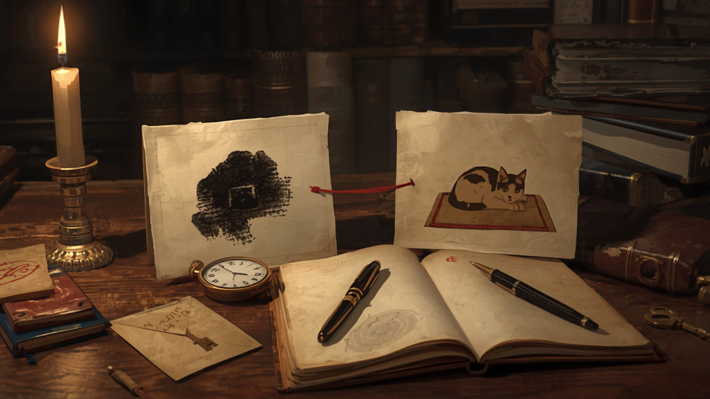

A black-and-white blotch sits on a screen for half a second. It is a photograph pushed to two tones: every pixel either full black or full white, with the edges and shading gone. Most people see shapes and nothing more. Then the original photograph appears, and the next time the blotch comes round it is plainly a face, or a kettle, or a dog lying on a rug, and you cannot get the blotch back.

These are Mooney images, named for Craig Mooney, who used two-tone faces in [a 1957 study of closure ability in children](https://doi.org/10.1037/h0083717). They are one of the cleanest puzzles in perception research: one exposure to the answer, and the puzzle is solved for good.

A paper published in *Nature Neuroscience* on 4 November, ["Single-neuron encoding of rapidly learned visual information reshapes human perception"](https://doi.org/10.1038/s41593-026-02496-6) by Marcelo Armendariz, Julie Blumberg, Gabriel Kreiman and colleagues, recorded what individual neurons do while that happens. The journal version is behind a paywall. I read the [bioRxiv preprint](https://doi.org/10.1101/2025.08.04.668333) posted in August 2025, so the figures below come from that version and may have shifted in review.

## The experiment

Thirteen people with drug-resistant epilepsy, who already had electrodes implanted at the Freiburg Epilepsy Center in Germany to locate their seizures, took part across 34 sessions. The team recorded 1,104 single neurons: some in the medial occipital cortex, early in the visual pathway, and the rest in the medial temporal lobe (parahippocampal cortex, entorhinal cortex, hippocampus and amygdala).

Each image appeared for 500 milliseconds. Participants first saw Mooney images and said whether they recognised them. Then came short learning segments, the original greyscale photograph followed straight away by its Mooney version. Then the Mooney images came back on their own.

The behaviour shifts almost all at once. Before learning, participants recognised the Mooney images 4% of the time on average. Afterwards it was 83%, against 93% for the greyscale photographs. It took one or a few learning segments, 1.8 on average.

## Same picture, different neurons

The neural finding I find most striking is the plainest one. The Mooney image before learning and the Mooney image after learning are identical on the screen, pixel for pixel. Neurons in both regions told them apart anyway. A decoder trained on the population's activity could distinguish before from after with up to 75% accuracy, peaking around 550 ms after the image appeared. The input did not change, and what the neurons did with it changed.

After learning, the responses to the Mooney image came to resemble the responses to the greyscale photograph. The neurons were, in effect, treating the blotch as the photo.

## Solved, but slower

They did not treat it as the photo at the same speed. Participants answered more slowly for learned Mooney images (median 0.53 seconds) than for greyscale photographs (0.48 seconds). Unrecognised Mooney images were slowest of all, at 0.60.

The neurons show where that time goes. When the team trained a decoder on responses to the greyscale photos and tested it on responses to the learned Mooney images, the best match came late: occipital activity to the photo at 175 ms looked most like activity to the learned blotch at 300 ms, a lag of about 125 ms. In the medial temporal lobe the match came later again, 325 ms against 425 ms. Individual medial temporal neurons fired about 110 ms later to the learned Mooney image than to the photograph, while the occipital neurons' first responses showed no difference in timing.

The authors' reading is that the visual cortex has to do extra work, plausibly recurrent processing with feedback from higher areas, to rebuild the object from the two-tone remnant before the identity is passed on to the medial temporal lobe. That fits an earlier result. Larry Squire, Biyu He and colleagues reported in *PNAS* in 2021 that [one-trial perceptual learning of this kind was fully intact in patients with hippocampal or wider medial temporal lobe damage](https://doi.org/10.1073/pnas.2104072118), and persisted for more than five months, even though those patients' memory for the images and the test was impaired. The learning seems to live in the visual cortex, and a patient does not need to remember the lesson to keep it.

## A door that only opens one way

Puzzle designers use this effect constantly and rarely name it. A picture that resolves into a hidden shape, an object camouflaged in a painted wall, a silhouette that reads as a map once you know which coastline it is: all of these are Mooney puzzles. The solve is a perceptual event, and it does not reverse.

That has consequences worth spelling out.

The first is for hints. A hint that shows the answer image is a different kind of hint from one that nudges a deduction. A deduction hint can be partial; a reveal finishes the puzzle permanently for everyone who saw it. A team member who glances at the screen when the hint arrives has lost the puzzle as completely as the one who asked for it. If the Squire result transfers to ordinary solvers, that player has also lost it for months, possibly without remembering that they ever saw it.

The second is for test-solving, which I wrote about yesterday in [*Who Cooks the Mechanism?*](/posts/2026-11-04-who-cooks-the-mechanism.html). A test-solver is valuable for what they do not know. With a deduction puzzle, a tester who has already seen the intended route can still check whether the steps hold. With a perceptual puzzle, a tester who has seen the answer is spent. Every person can test a Mooney-style puzzle cold exactly once, and the designer, who has seen the answer more than anyone, is the one person who can never judge it fresh.

The slower reading matters too, for difficulty estimates. Once solved, the picture is obvious to the designer, but obvious and instant are different things. The brain is still rebuilding the object every time, about a tenth of a second later than it would for a clear photograph. A designer who timed their own recognition would underestimate the work and overestimate how vivid the shape is.

## What I would ask next

The study measured recognition within a session. Squire's patients kept the effect for months. Neither paper, in what I read, tests whether the extra processing time shrinks with repetition. If the hundred-odd milliseconds stay, a solved Mooney image is a puzzle the brain re-solves at every viewing without telling you. If they shrink, there must be a point where it becomes simply a picture. Where is that point, and does a solver feel it?

<!--
HERO_IMAGE_PROMPT:
Romantic painterly illustration in the manner of Nick Bantock's Griffin & Sabine meets Bletchley Park 1942, sepia and candlelight, photographic-painterly composition, not photorealistic. On a worn oak desk lit by a single candle, two antique paper cards lie side by side: the left card shows a stark two-tone black-and-white blotch pattern of an abstract hidden shape, the right card shows a soft sepia painted study of a small cat curled on a rug, the same outline as the blotch. A thin red string runs from the soft study to the blotch card, pinned with a brass tack. Between them a brass stopwatch lies open, its hand caught just past the start. A brass magnifying lens rests on the blotch card. An open cipher notebook beside them holds faint hand-inked concentric curves in iron-gall ink, a fountain pen resting across its gutter, a small wax-sealed envelope and a brass key at the edge of the frame. Shelves of old books recede into candle haze. Mysterious, contemplative, pattern-recognition mood. No human figures anywhere. No legible text. 16:9 horizontal composition.
-->

<!--
SOCIAL_CAPTIONS:

INSTAGRAM:
One look at the original photo, and a two-tone blotch becomes a face you can never unsee. Neurons recorded in thirteen patients show the brain still pays roughly a tenth of a second extra to see it.

Full piece linked in bio.

#mooneyimages #perception #cognitivescience #puzzledesign #neuroscience #patternrecognition
-->
